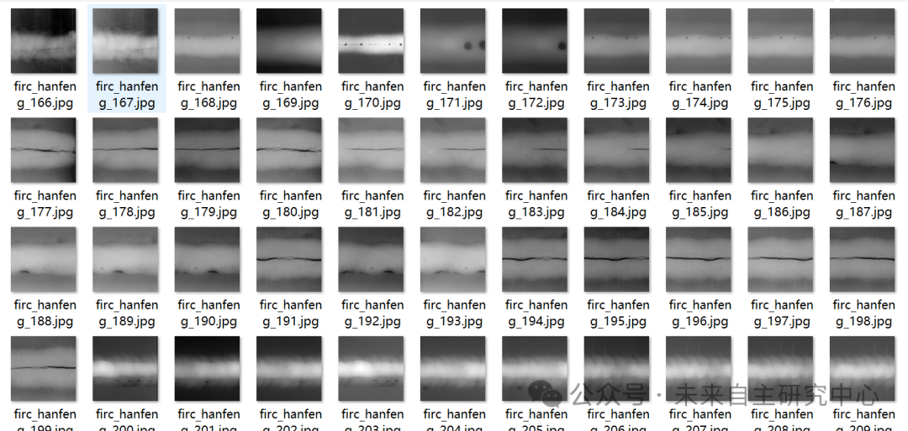
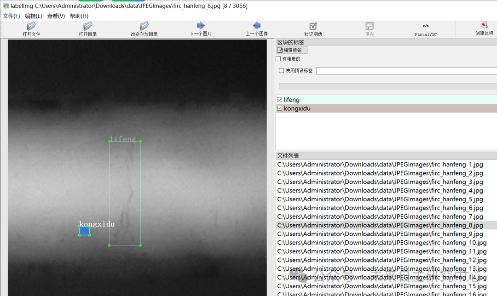

# X-ray film weld defect detection dataset in VOC+YOLO format with 3056 images across 5 categories

Dataset format: Pascal VOC format + YOLO format (txt file without split path, only containing jpg images and corresponding VOC format xml files and yolo format txt files)

Number of images (number of jpg files): 3056

Number of annotations (number of xml files): 3056

Number of annotations (number of txt files): 3056

Label category count: 5

Annotation category names: ["jiazha", "kongxidu", "lifeng", "weihantou", "weironghe"] => ["Jiaza", "Kongxidu", "Crack", "Weihantou", "Weironghe"]

Number of boxes labeled in each category:

Jiazha Frame Count = 1532

Kongxidu Frames = 2632

Lifeng Frame Count = 1871

Weihantou Frame Count = 1072

Weironghe Frames = 1210

Total frame count: 8317

Using labelImg:

Annotation rules: Draw a rectangle around the category.

Important Notice: No

Special : This dataset does not guarantee the accuracy or precision of the trained models or weight files. The dataset is provided with accurate and reasonable annotations only.

Image Preview:

Annotation example:

## Payment

Here is a pay link on Stripe ( https://buy.stripe.com/3cs8yP7sY87d0vu9AB ). Please contact me lonlonago@foxmail.com after funding $89, and I will send you a complete data files , thank you!

